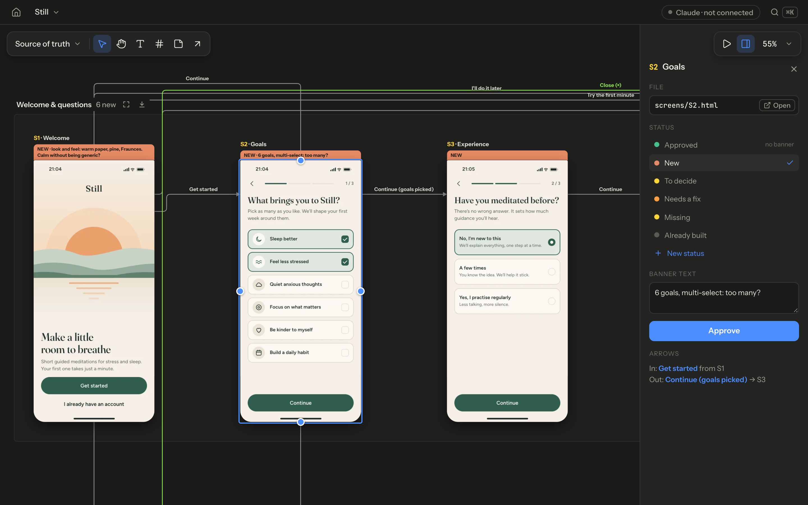

# Agent Design Lab

A local canvas where **Claude Code designs your app or website** as live HTML screens joined by labelled arrows, you
review it like a Figma file, and the approved design becomes **the source of truth you hand to the build**.



- **Agent first.** You don't draw. You ask Claude Code ("design an onboarding flow for a meditation app") and it writes
  real HTML screens with real copy, a design system, every state (empty, error, permission denied …) and the arrows
  between them. They appear on the canvas while it works.
- **A wireflow, not a pile of mockups.** Screens are joined by arrows that say what the person taps or what condition
  sends them there. Sections group flows, notes hold comments, ⌘K finds any word inside any screen, and present mode
  lets you click through the flow.
- **Review in place.** Give screens a status (Needs a fix, To decide, your own) with a banner text saying what to change.
  Claude sees what you changed on its next turn and works through it. Alternatives arrive as proposals: "Use instead"
  or reject. Nothing is ever lost (there is a History page).
- **A source of truth for the build.** `adl handoff` turns the approved screens into a spec (flows, transitions,
  tokens, copy, reference pictures), and `adl handoff check` tells the agent building the real app when it matches.
- **Fast with hundreds of screens.** Animations keep running (CSS, exactly as written) on the screens you look at, and
  zoomed-out screens are drawn from cached pictures. 161 real screens open in about 0.3 s and pan at 60 fps.
- **Sound, when you want it.** A screen can make sounds in time with its animations. The canvas stays silent until you
  click a screen's speaker; then that one screen plays, every other stays quiet.
- **Local files you own.** Plain HTML, CSS and JSON in your folder, git friendly. Nothing leaves your machine.

## Start

You need Node 22.18 or newer, Google Chrome (or Edge or Chromium) and [Claude Code](https://claude.com/claude-code).

```sh
git clone https://github.com/LucaL1fe/agent-design-lab
cd agent-design-lab
npm install
npm start            # opens the canvas in Chrome
```

Then open Claude Code in the same folder and ask for a design:

```
claude
> Design an onboarding flow for a meditation app
```

Designs go into `workspace/`. Watch them appear, then comment through statuses and notes, ask for changes, approve.
Every Projects page also shows a built-in example to look around in (a meditation app onboarding Claude designed with
this tool). It stays as it is; "Make a copy" (or `adl copy example-still`) gives you your own copy to edit.

### In your own project

Install it from GitHub in any repo (it is not on npm) and set the folder up once, so Claude Code knows the designer
skill and the canvas sees what it does:

```sh
npm install --save-dev github:LucaL1fe/agent-design-lab
npx adl setup        # adl.json, the skill, the hooks, a section in CLAUDE.md and AGENTS.md
npx adl open
```

Or install the skill and hooks as a Claude Code plugin, and the package from GitHub as above for the CLI (`npx adl`):

```
/plugin marketplace add LucaL1fe/agent-design-lab
/plugin install agent-design-lab@agent-design-lab
```

## How it works

```
you ask ──▶ Claude writes screens/*.html + runs adl commands ──▶ the canvas updates live
   ▲                                                                   │
   └── Claude reads what you changed (adl context) ◀── you move things, set statuses,
                                                       write banner texts and notes, approve
approved screens ──▶ adl handoff ──▶ another agent builds the app ──▶ adl handoff check until it passes
```

- **Files are the interface.** A project is a folder: `project.json`, `pages/*.json` (items and arrows), `screens/*.html`
  (standalone documents that open in any browser), `styles/tokens.css` and `components.css`. Claude edits them with
  commands or directly. The canvas server is the only writer of page files and merges an agent's file writes with your
  live edits: the agent wins conflicts, except where you placed something by hand.
- **The skill is the designer.** `skills/agent-design-lab/SKILL.md` gives Claude a process: a short brief, the design
  system first, the wireflow before pixels, every state, rendering its own screens to PNG and looking at them before it
  reports, banner texts for what you should look at, never approving its own work.
- **Hooks connect the two.** The pill in the top bar shows what Claude is doing ("writing S6a.html") and how many of
  your changes it will see next. The hooks only talk to the local server.

## The canvas

| Key | |
|---|---|
| Drag, ⌘ scroll, pinch | pan and zoom; ⇧1 fit all, ⇧2 fit selection, ⇧0 100 % |
| V · H · T · S · N · A | select, hand, text, section, note, arrow |
| Drag from a screen's edge handle | draw an arrow; double-click an arrow to label it |
| ⌘K | search ids, captions, banners, notes, labels and the words inside screens |
| P | present: walk the flow from the selected screen (→ next, ← back, Esc) |
| ⌘Z · ⇧⌘Z · ⌘D · ⌫ | undo, redo, duplicate, take off the page |

The side panel (⌥I) shows the selected screen's file, status, banner text and arrows. Click **Approve** when a screen is
right; approved screens drop their banner and become part of the handoff.

## Commands

`adl help` lists everything; the full reference is in
[skills/agent-design-lab/reference/commands.md](skills/agent-design-lab/reference/commands.md). The ones you will use:

| Command | |
|---|---|
| `adl open` | start the canvas for this folder and open it (focuses the tab if it is open) |
| `adl setup` · `adl doctor` | prepare a folder for Claude Code; check Node, Chrome, skill and hooks |
| `adl list` · `adl context` | projects and pages; what you changed and what is waiting (what Claude reads) |
| `adl render --flow S1` | a picture of a flow, for looking at it outside the canvas |
| `adl handoff` · `adl handoff check` | the build spec from approved screens; compare a built app with it |

In a clone of this repo the command is `./adl`; in a project with the package installed it is `npx adl`.

## Building from the design

`adl handoff` writes `handoff/` next to the project:

- `HANDOFF.md`: how to build it, the frames, the tokens, every flow with its transitions and triggers, and each
  screen's requirements (from notes), anchors, animations, sounds and copy.
- `spec.json` (with a JSON schema), `tokens.json` (W3C design tokens), `components.md`, `flows.mmd` (Mermaid).
- `png/`: a reference picture per screen; `source/`: the design's HTML, CSS and assets.

Give the folder to the agent that builds the app ("here is the source of truth, build exactly this"). It fills
`adl-routes.json` with the URL of each screen and runs `adl handoff check`. The check compares every screen with its
picture (structural similarity), looks for missing copy, taps every transition, and writes side-by-side pictures of
what differs. The build is done when it passes.

### Checking the real product against the design

For products that are not web pages (a mobile app), the canvas keeps a build check next to the design. Every screen and
flow gets a build state: not built, building, **matching**, deviating or blocked (the last two with a reason). Agents
attach screenshots and recordings of the real product per device (`adl capture S4 phone shot.png`); the canvas switch
**Design · tablet · phone** (key D) shows them in place of the screens, and **Compare** (key C) is a checklist with the
design next to every capture, where the person changes states and writes why something deviates. Flows (`adl flow
add`) get their own state and a video of the whole journey. A screen counts as done only when it is matching.

## Development

See [docs/dev.md](docs/dev.md) and [CONTRIBUTING.md](CONTRIBUTING.md). `npm run check` runs the type checks, Biome and
the tests; `npm run e2e` the browser tests; `npm run bench` the performance bench.

## License

MIT. The example fonts in `examples/still/assets/fonts` are under the SIL Open Font License (licence files next to them).
